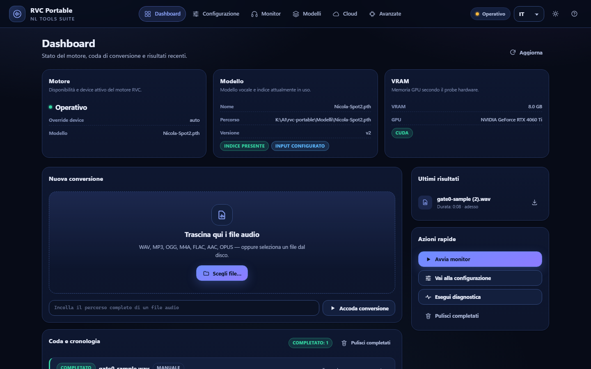
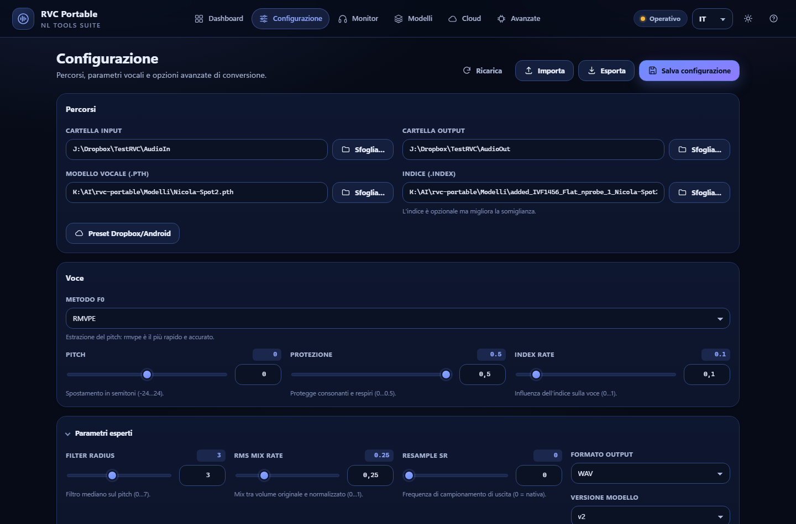
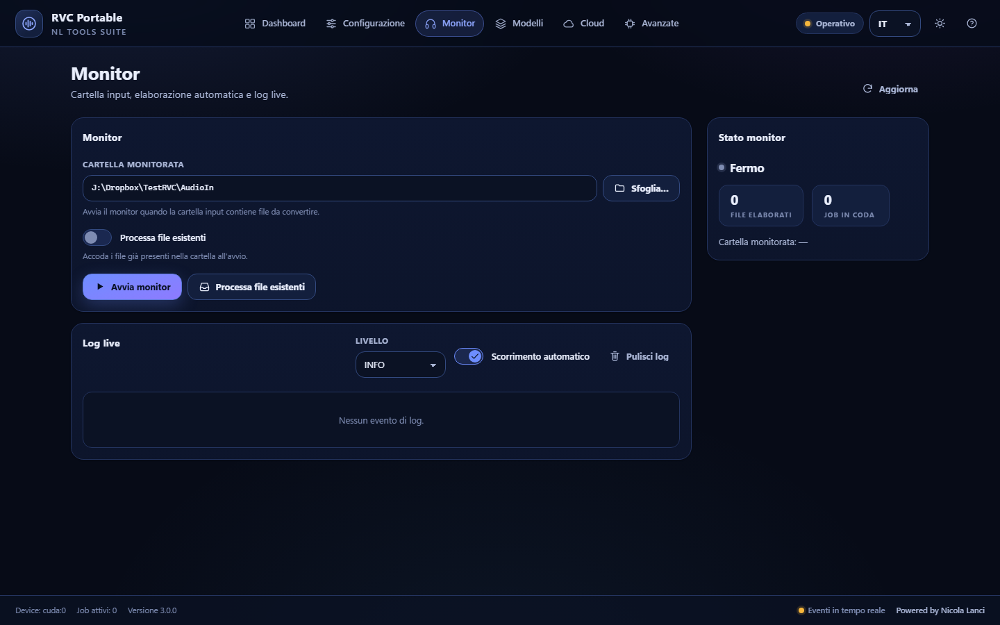
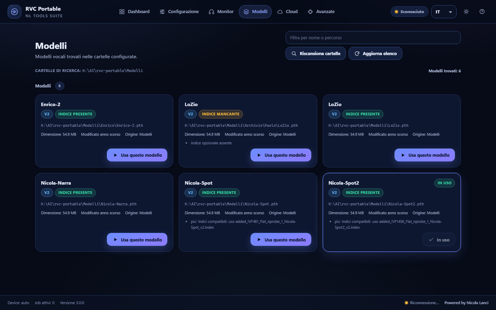
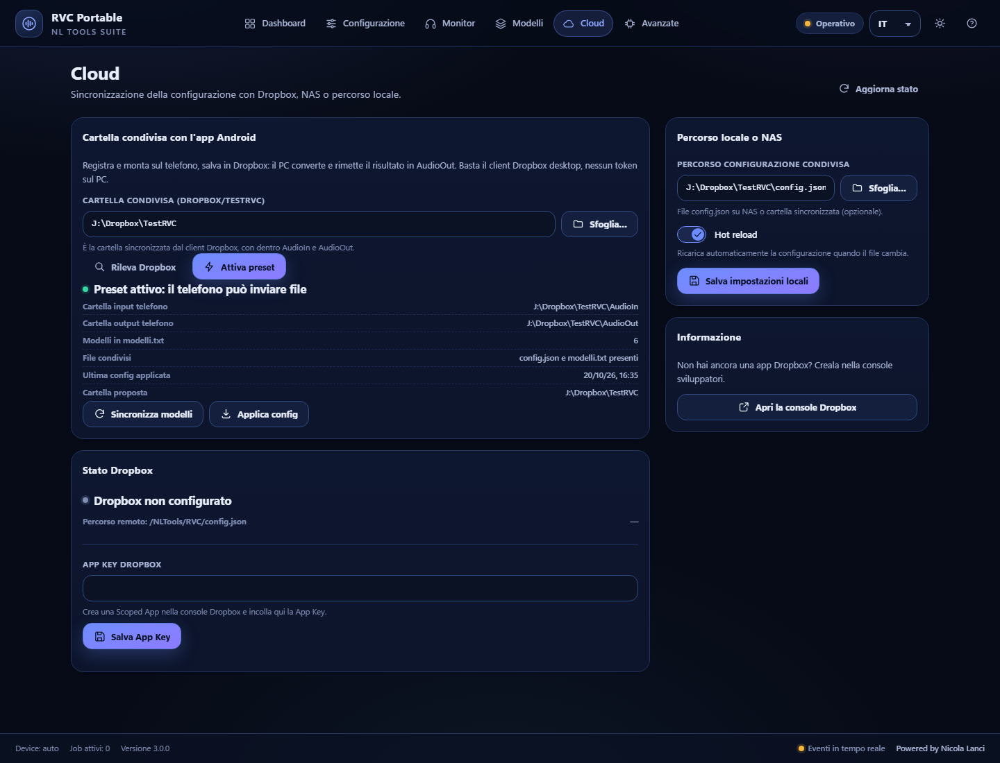
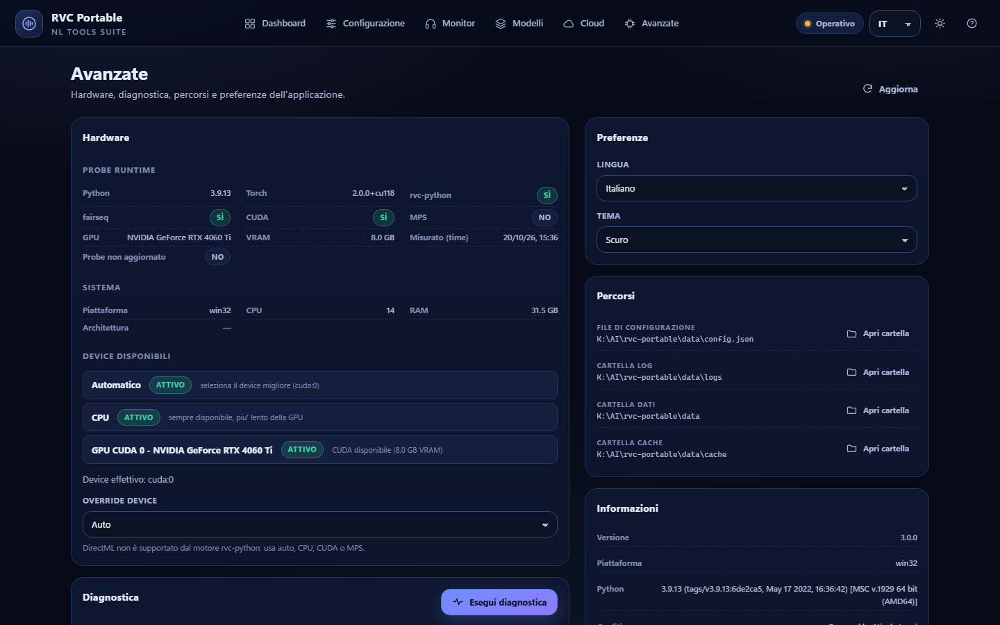
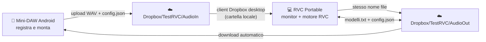
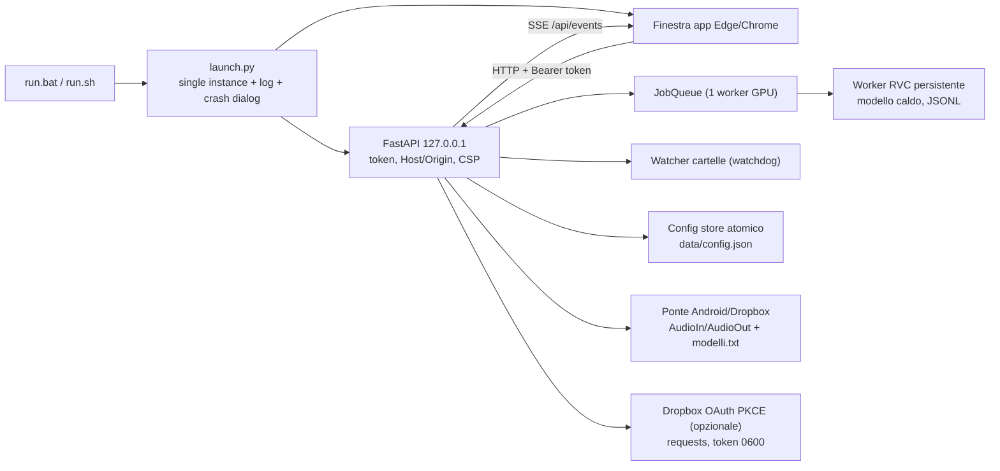

# 🎙️ RVC Portable — NL Tools Suite

**Il PC che converte la voce per il tuo telefono, tramite Dropbox.**
Registri e monti nella mini-DAW Android → il WAV finisce in una cartella Dropbox → RVC Portable
(Windows/macOS/Linux) lo converte in automatico e rimette il risultato in Dropbox, pronto da
importare sul telefono. Oppure usi tutto in locale: monitori una cartella a scelta, il PC converte
e archivia i risultati dove vuoi.

Si installa **da solo in una cartella a tua scelta**: il repository resta leggero (~3 MB),
`setup.bat` scarica una volta il runtime del motore (~3,5 GB) e poi tutto funziona offline,
senza console e senza installazioni di sistema.

<p align="center">
  
</p>

<p align="center">
  
  
</p>

| | |
|---|---|
| **Versione** | 3.0.0 |
| **Motore** | rvc-python 0.1.5 + fairseq 0.12.2 + PyTorch 2.0.0 (CUDA 11.8) |
| **Runtime Windows** | CPython 3.9.13 portatile, scaricato al primo `setup.bat` (~3,5 GB) |
| **Runtime macOS/Linux** | Python 3.10 + venv gestito da `tools/bootstrap.py` |
| **Repository** | solo sorgenti (~3 MB): runtime e modelli non sono versionati |
| **UI** | SPA statica (HTML/CSS/JS, zero build) + FastAPI locale |
| **Lingue** | Italiano / English (cambio istantaneo) |

<p align="center">
  <a href="docs/img/models.png"></a>
  <a href="docs/img/cloud.png"></a>
  <a href="docs/img/advanced.png"></a>
</p>

---

## 🔄 Il flusso principale: telefono → Dropbox → PC → Dropbox → telefono



1. Sul **telefono**: registri, tagli, monti e premi *CONVERTI CON RVC* (l'app Android invia il WAV).
2. Sul **PC**: apri l'app → **Cloud → Attiva preset Android/Dropbox** una volta sola. Il PC
   monitora `AudioIn`, applica il config scelto dal telefono e scrive `AudioOut/<stesso nome>.wav`.
3. Sul **telefono**: il risultato compare da solo nel mixer.

Nessun token Dropbox sul PC e nessuna GPU sul telefono: basta il **client Dropbox desktop**.
Guida completa: **[docs/ANDROID-BRIDGE.md](docs/ANDROID-BRIDGE.md)**.

---

## ✨ Cosa fa

- **Ponte Android/Dropbox**: preset con auto-rilevamento Dropbox, cartelle condivise
  `AudioIn`/`AudioOut`, `modelli.txt` generato dai modelli del PC, config ibrida letta sia dal PC
  sia dall'app Android, hot-reload e output con lo stesso nome del file ricevuto. Il PC pubblica
  `status.json` ogni pochi secondi, così dall'app puoi vedere se è online e **cambiare i parametri
  RVC da remoto** (pitch, metodo, index rate, protezione, modello) senza aprire porte o VPN.
- **Monitoraggio di una cartella a scelta** (Dropbox, NAS, OneDrive, locale): ogni nuovo file audio
  (`.wav .mp3 .ogg .m4a .flac .aac .opus .wma`) viene accodato e convertito automaticamente, con
  deduplica, attesa di scrittura completa e avvio automatico all'apertura se configurato.
- **Coda di conversione** con un solo worker GPU: progresso, annullamento, retry su crash,
  modello caldo in cache (niente re-import di torch per ogni file).
- **Modelli e indici**: scansione di `Modelli/` e di **cartelle extra** (es. una cartella Dropbox),
  abbinamento `.pth` + `.index`, compatibilità automatica `trained_*` → `added_*`.
- **Configurazione completa**: cartelle, modello, pitch, metodo F0 (`rmvpe`, `harvest`, `crepe`, `pm`),
  protezione consonanti, index rate, parametri esperti, device (auto/CPU/CUDA/MPS).
- **Cloud**: sincronizzazione del `config.json` tramite **cartella locale/Dropbox/NAS** (consigliata,
  hot-reload) oppure **Dropbox OAuth2 PKCE** per chi non usa il client desktop.
- **Diagnostica guidata**: hardware, CUDA, motore, pesi base, percorsi, spazio disco, permessi,
  ponte Android, con suggerimenti di correzione.
- **Sicurezza locale**: token di sessione, solo loopback, controllo Host/Origin, CSP senza inline,
  nessun CORS.
- **Nessun errore silenzioso**: log su file, dialog nativo in caso di crash, variante `run-console.bat`.

---

## 🚀 Installazione

Scegli una cartella scrivibile (l'app è portatile: nessun amministratore, `data/` creata lì).
Guida completa per sistema: **[docs/INSTALL.md](docs/INSTALL.md)**.

Dopo il primo avvio: **Cloud → Rileva Dropbox → Attiva preset** per il flusso Android, oppure
**Configurazione** per scegliere a mano cartella input/output e modello.

### Windows 10/11 (x64)

```bat
git clone https://github.com/Nicotina4ever/rvc-portable.git "D:\App\RVC-Portable"
cd /d "D:\App\RVC-Portable"
setup.bat     :: scarica il runtime (~3,5 GB, una volta), verifica SHA-256 ed estrae
run.bat       :: avvia l'app senza finestra CMD
```

Senza git: scarica lo ZIP del repository da GitHub e scompattalo nella cartella scelta.
Per l'installazione offline: `set "RVC_RUNTIME_ZIP=D:\Download\runtime.zip"` e poi `setup.bat`.
Dettagli e troubleshooting: [docs/INSTALL-WINDOWS.md](docs/INSTALL-WINDOWS.md).

### macOS 12+ (Apple Silicon / Intel)

```bash
git clone https://github.com/Nicotina4ever/rvc-portable.git ~/Applications/RVC-Portable
cd ~/Applications/RVC-Portable
chmod +x setup.sh run.sh run.command
./setup.sh          # crea runtime/ (venv Python 3.10) e installa il motore
./run.command       # oppure doppio click nel Finder
```

Prerequisiti: Python 3.10+, Xcode Command Line Tools (per compilare fairseq), `ffmpeg` non necessario.
MPS è **sperimentale**: in caso di problemi imposta device `cpu` nelle Avanzate.
Guida: [docs/INSTALL-MACOS.md](docs/INSTALL-MACOS.md).

### Linux (x86_64)

```bash
git clone https://github.com/Nicotina4ever/rvc-portable.git ~/opt/rvc-portable
cd ~/opt/rvc-portable
chmod +x setup.sh run.sh
./setup.sh --profile cuda118    # oppure --profile cpu
./run.sh
```

Prerequisiti: Python 3.10+, `build-essential`, `libsndfile1`; per CUDA i driver NVIDIA.
Guida: [docs/INSTALL-LINUX.md](docs/INSTALL-LINUX.md).

### Aggiornare

```bash
cd /percorso/rvc-portable
git pull
```

I dati in `data/` e i modelli in `Modelli/` non vengono toccati. Se cambiano i requisiti,
rilancia `setup.bat` / `./setup.sh`.

---

## 🗂 Struttura

```text
rvc-portable/
├─ run.bat / run.sh / run.command   # launcher (nessuna console su Windows)
├─ setup.bat / setup.sh             # installer: scarica/prepara il runtime
├─ install.conf                     # URL + hash del runtime Windows della Release
├─ launch.py                        # entry point Python
├─ app/                             # backend: API, motore, ponte Android, configurazione
├─ web/                             # interfaccia SPA (zero build)
├─ locales/                         # traduzioni IT/EN condivise
├─ tools/                           # bootstrap, build runtime asset, release, check repo
├─ requirements/                    # pin divisi tra base, motore e acceleratori
├─ tests/                           # unit, integrazione, end-to-end
├─ docs/                            # installazione, Android/Dropbox, architettura, pubblicazione
├─ data/                            # (creata al primo avvio) config, log, cache, stato
├─ runtime/                         # (scaricata da setup) Python portatile con il motore
├─ Modelli/                         # i tuoi modelli .pth/.index (mai modificati)
└─ dist/                            # (locale) archivi/release, non versionata
```

Nel repository git **non** finiscono `runtime/`, `Modelli/`, `data/`, `dist/`, `da_eliminare/`
e `.dev/`: vedi `.gitignore` e `tools/check_repo.py`.

### Documentazione

| Guida | Contenuto |
|---|---|
| [docs/INSTALL.md](docs/INSTALL.md) | installazione per Windows/macOS/Linux, cartella a scelta, aggiornamenti |
| [docs/ANDROID-BRIDGE.md](docs/ANDROID-BRIDGE.md) | flusso telefono ↔ Dropbox ↔ PC, `modelli.txt`, config, problemi |
| [docs/CLOUD-SYNC.md](docs/CLOUD-SYNC.md) | sincronizzazione config via cartella locale o Dropbox API |
| [docs/ARCHITECTURE.md](docs/ARCHITECTURE.md) | backend, motore, coda job, sicurezza |
| [docs/API-CONTRACT.md](docs/API-CONTRACT.md) | endpoint, schema impostazioni, eventi SSE |
| [docs/TROUBLESHOOTING.md](docs/TROUBLESHOOTING.md) | diagnosi e rimedi |
| [docs/PUBLISHING.md](docs/PUBLISHING.md) | pubblicare su GitHub e creare l'asset runtime |
| [CONTRIBUTING.md](CONTRIBUTING.md) | sviluppo, test, regole del progetto |

---

## 📦 Release e pubblicazione

- Il runtime Windows completo (~3,5 GB) è un **asset della Release GitHub**, non un file del
  repository: `setup.bat` lo scarica e ne verifica l'hash SHA-256.
- Per creare l'asset: `runtime\python.exe -B tools\build_runtime_asset.py --repo Nicotina4ever/rvc-portable --update-install-conf`
  (divide automaticamente in parti se supera il limite GitHub di 2 GiB per asset).
- Guida completa per il maintainer: **[docs/PUBLISHING.md](docs/PUBLISHING.md)**.
- Archivi sorgente per OS: `python tools/make_release.py --target windows --target macos --target linux`.

---

## 🧠 Come funziona



- **Frontend e backend separati**: l'API è testabile e riutilizzabile (anche headless), la UI è
  statica e si aggiorna senza build.
- Nessuna dipendenza da Node/Electron a runtime: usa il browser già installato.
- Il backend **non importa torch**: il motore gira in un processo separato, riavviabile e cancellabile.

Dettagli: [docs/ARCHITECTURE.md](docs/ARCHITECTURE.md) · Confronto architetture: [docs/COMPARISON.md](docs/COMPARISON.md).

---

## ⚙️ Configurazione e dati

Al primo avvio viene creata la cartella `data/` accanto all'app (se non scrivibile, nella cartella
utente del sistema). Il vecchio `config.json` piatto viene migrato automaticamente allo schema v3.

```text
data/
├─ config.json        # impostazioni (scrittura atomica + backup .bak)
├─ logs/              # app.log, engine.log, stdout.log
├─ state/             # sessione, dropbox token, job recenti, dedupe watcher
└─ cache/             # waveform, alias indici
```

Opzioni utili:

```bash
python -m app --help
python -m app --doctor          # diagnostica completa
python -m app --headless        # solo server (stampa l'URL con token)
python -m app --data-dir D:\RVC --config D:\RVC\config.json
```

---

## ☁️ Dropbox

1. Crea una **Scoped App** gratuita su [dropbox.com/developers/apps](https://www.dropbox.com/developers/apps)
   con permessi `files.content.read` e `files.content.write` (nessun redirect URI).
2. Copia la **App Key** nella tab **Cloud** e premi **Salva Key**.
3. Premi **Connetti**: si apre il browser, autorizza e incolla il codice nella UI.
4. Usa **Carica** / **Scarica** per sincronizzare il `config.json`.

In alternativa scegli un percorso locale/Dropbox/NAS e abilita l'hot-reload.
Guida completa: [docs/CLOUD-SYNC.md](docs/CLOUD-SYNC.md).

> L'errore storico *Invalid client_id* significava che la App Key predefinita non era registrata:
> ora la chiave è configurabile e gli errori sono tradotti in azioni concrete.

---

## 🩺 Diagnostica e log

```bash
python -m app --doctor            # umano
python -m app --doctor-json       # macchina
```

I log sono in `data/logs/app.log` (rotazione 2 MB × 5). Se l'app non parte, `data/logs/stdout.log`
contiene l'output del launcher, `data/logs/fatal.log` gli errori fatali.

Problemi comuni: [docs/TROUBLESHOOTING.md](docs/TROUBLESHOOTING.md).

---

## 🛠 Sviluppo

```bash
python tools/bootstrap.py --dev          # pytest + ruff in .dev/site-packages
python tools/dev.py test                 # test unitari + integrazione
python tools/dev.py lint                 # ruff
python tools/dev.py check-web            # sintassi JS (node)
python tools/dev.py check-repo           # igiene repository per GitHub
python tools/dev.py i18n                 # coerenza cataloghi IT/EN
```

La CI GitHub Actions esegue lint, test su Windows/macOS/Linux e Python 3.9/3.12, validazione
i18n e controllo igiene del repository (`tools/check_repo.py`). Il runtime Windows non è
ricostruito in CI: si pubblica come asset della release (vedi [docs/PUBLISHING.md](docs/PUBLISHING.md)).

Per contribuire: [CONTRIBUTING.md](CONTRIBUTING.md).

### Compatibilità motore (importante)

- **PyTorch < 2.6 è obbligatorio**: da 2.6 `torch.load` usa `weights_only=True` e i checkpoint
  fairseq (HuBERT) non si caricano più.
- **DirectML non è supportato** da rvc-python: la UI non lo espone e `dml:0` viene rifiutato.
- Il metodo F0 `fcpe` non è accettato da rvc-python 0.1.5: la UI espone solo `rmvpe`, `harvest`,
  `crepe`, `pm`.

---

## 🧹 Riordino e quarantena (solo in locale)

I file superflui/vecchie distribuzioni non vengono cancellati: sono spostati in `da_eliminare/`
con inventario e log in [docs/CLEANUP-LOG.md](docs/CLEANUP-LOG.md). Questa cartella è **locale**
e non è versionata: chi clona il repository non la trova. Sul repository di sviluppo:

```bash
python tools/quarantine.py            # dry-run
python tools/quarantine.py --apply
python tools/quarantine.py --restore
```

`Modelli/` e `Progetto/Articolo Blog/` non vengono mai toccati. Il runtime può essere sfoltito
con `python tools/trim_runtime.py` (sposta, non cancella; `--restore` ripristina).

---

## 🇬🇧 English quickstart

Portable RVC voice conversion, multi-OS, with a local FastAPI backend and a zero-build web UI.
The repo is source-only; the heavy engine runtime is a GitHub Release asset downloaded on first
setup, so the project installs itself into any folder you choose.

1. **Windows**: `git clone` (or download the ZIP) into a writable folder, run `setup.bat`
   (downloads the runtime, verifies SHA-256), then `run.bat`.
2. **macOS/Linux**: `chmod +x setup.sh run.sh && ./setup.sh && ./run.sh` (Python 3.10+ required).
3. **Phone ↔ PC (the main flow)**: Cloud tab → *Detect Dropbox* → *Apply preset*. The PC monitors
   `Dropbox/TestRVC/AudioIn`, converts every file and writes `AudioOut/<same name>.wav` for the
   Android mini-DAW app; no Dropbox token needed on the PC (desktop client only). Then pick your
   `.pth`/`.index` and start the monitor (it can auto-start at launch).

Diagnostics: `python -m app --doctor`. Cloud sync: desktop Dropbox folder (recommended) or Dropbox
OAuth PKCE with your own App Key ([docs/CLOUD-SYNC.md](docs/CLOUD-SYNC.md)). Android workflow:
[docs/ANDROID-BRIDGE.md](docs/ANDROID-BRIDGE.md). Logs in `data/logs/`. Full guide:
[docs/INSTALL.md](docs/INSTALL.md); maintainer guide: [docs/PUBLISHING.md](docs/PUBLISHING.md).

---

## 📄 Crediti

- **Autore / progetto**: Nicola Lanci — [www.nicolalanci.com](https://www.nicolalanci.com)
- **Motore**: [rvc-python](https://github.com/daswer123/rvc-python) (MIT), [RVC Project](https://github.com/RVC-Project),
  [fairseq](https://github.com/facebookresearch/fairseq) (MIT), [PyTorch](https://pytorch.org) (BSD),
  [Faiss](https://github.com/facebookresearch/faiss) (MIT), [PyAV](https://github.com/PyAV-Org/PyAV) (BSD).
- **UI**: HTML/CSS/JS scritti a mano, nessuna risorsa esterna, icone SVG originali.

Licenza del progetto: **MIT** — vedi [LICENSE](LICENSE). (`git log` iniziale:
[docs/PUBLISHING.md](docs/PUBLISHING.md)); senza un file `LICENSE` valgono tutti i diritti riservati.
I componenti di terze parti (rvc-python, RVC, fairseq, PyTorch, Faiss, PyAV) mantengono le proprie licenze.
