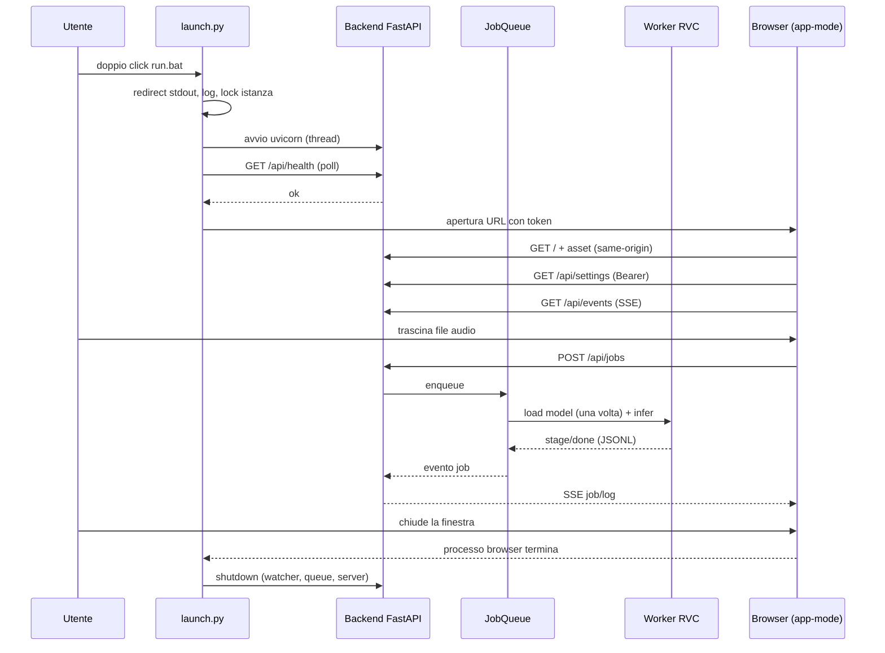

# Architettura — RVC Portable 3.0

## 1. Obiettivi

1. **Un solo modo di avviare** l'app su Windows/macOS/Linux, senza console e senza installazioni.
2. **Motore RVC affidabile**: un worker persistente, modello caldo, cancellazione e diagnosi.
3. **UI moderna e manutenibile**: frontend e backend separati, API testabile, nessun build step.
4. **Nessun errore silenzioso**: log, diagnostica, dialog di crash.
5. **Portabilità reale**: dati e config accanto all'app, runtime per-OS documentato.

Non-obiettivi: training/creazione indice, accesso LAN pubblico, auto-update, DirectML/ONNX.

## 2. Modello di processo

Componenti:

| Componente | File | Responsabilità |
|---|---|---|
| Launcher | `launch.py`, `app/launcher.py`, `app/cli.py` | avvio, token, istanza singola, browser, crash dialog, spegnimento |
| Backend HTTP | `app/api/**` | REST + SSE, statici, sicurezza, validazione |
| Config store | `app/settings.py` | schema v3, migrazione, scrittura atomica, patch |
| Job queue | `app/core/jobs.py` | FIFO, un worker, cancel, retry, dedupe, persistenza |
| Motore | `app/core/engine.py`, `engine_rvc.py`, `worker.py` | contratto, spawn worker, JSONL, patch rvc-python |
| Watcher | `app/core/watcher.py` | watchdog nativo/polling, stabilità file, dedupe |
| Dispositivi | `app/core/devices.py` | probe runtime in sottoprocesso (niente torch nel backend) |
| Diagnostica | `app/doctor.py` | check con `fix_hint` |
| Cloud | `app/cloud/dropbox.py` | OAuth PKCE, refresh, upload/download, conflitti |
| Ponte Android | `app/android_bridge.py` | rilevamento Dropbox locale, `modelli.txt`, config ibrida, `ConfigSync` hot-reload |
| Frontend | `web/**`, `locales/**` | SPA statica, i18n, temi, player audio |
| Tooling | `tools/**` | bootstrap multi-OS, quarantena, release, asset runtime, dev |

## 3. Perché frontend web + backend locale

| Criterio | CustomTkinter (v2) | **Web SPA + FastAPI (v3)** | Electron/Tauri |
|---|---|---|---|
| Peso extra distribuzione | ~0 | **~0 (browser di sistema)** | +80–150 MB |
| Avvio | 1–2 s + torch nel processo UI | **backend ~1–2 s + finestra ~1 s** | 2–4 s |
| Aspetto e UX | datato, difficile da evolvere | **alto, temi, animazioni, responsive** | alto |
| Stesso codice su 3 OS | sì (Tk) | **sì (browser)** | sì |
| Testabilità | scarsa | **API + E2E** | media |
| Toolchain richiesta | nessuna | **nessuna (zero build)** | Node/Rust |
| Accesso remoto opt-in | no | **sì (token, off di default)** | no |

Decisioni correlate:

- **SSE invece di WebSocket**: unidirezionale, riconnessione nativa, meno dipendenze, stesso
  comportamento dietro loopback. Le azioni restano normali POST.
- **Nessun bundler**: moduli ES nativi, CSS scritto a mano, SVG inline. Zero `node_modules`
  nella distribuzione, nessun CDN, funziona offline.
- **Client Dropbox con `requests`**: niente SDK (pesante e con dipendenze proprie), PKCE
  implementato direttamente, errori mappati. Il token vive in `data/state/dropbox.json`.
- **Niente ffmpeg**: rvc-python usa PyAV (`av`) per decodifica/encoding; la distribuzione non
  richiede binari esterni.
- **Finestra app**: Edge/Chrome con `--app=URL` e profilo dedicato in `data/browser`; se il
  browser non è disponibile si apre una scheda normale e il server si spegne per inattività.

## 4. Sicurezza

| Minaccia | Contromisura |
|---|---|
| Altre pagine web raggiungono `127.0.0.1` | token Bearer/`?t=` obbligatorio su `/api/*`; `Sec-Fetch-Site`/`Origin` same-origin; nessun CORS |
| DNS rebinding | validazione header `Host` (solo loopback, salvo `--allow-lan` esplicito) |
| XSS nella UI | CSP senza inline script, nessuna risorsa remota, escaping dei testi |
| Furto token locale | file `data/state/session.json` con permessi ristretti; token per avvio |
| Segreti nei log | redazione di token/codici; il refresh token non viene mai loggato |
| Path traversal | statici montati su directory note; endpoint audio solo per job esistenti |

## 5. Configurazione (schema v3)

- `data/config.json` annidato (`audio`, `engine`, `monitor`, `cloud`, `android`, `ui`),
  `schema_version: 3`.
- Migrazione automatica dal v2 piatto: `fcpe` → `rmvpe`, `dml:0` → `auto`, con warning.
- Scrittura atomica: file temporaneo + `fsync` + `os.replace`; copia precedente in `.bak`.
- Hot-reload: `ConfigSync` osserva `cloud.local_path` (poll ~2 s, hash del contenuto) e applica
  config v3 oppure il formato piatto dell'app Android; evento SSE `config` per la UI.
- Config condivisa "ibrida": quando il ponte Android è attivo, il `config.json` scritto in Dropbox
  contiene sia lo schema v3 annidato sia le chiavi piatte (`pitch`, `method`, `model_path`, …) che
  l'app Android legge: un solo file per PC e telefono.
- Portatile per default (`data/` accanto all'app), fallback alla cartella utente se non scrivibile.

## 6. Motore RVC: vincoli e patch

Il runtime Windows è **CPython 3.9.13 + torch 2.0.0+cu118 + rvc-python 0.1.5 + fairseq 0.12.2**
(ricetta storicamente verificata del progetto). Il worker:

1. imposta `CUDA_VISIBLE_DEVICES` **prima** dell'import di torch (per rispettare la scelta utente:
   `Config.device_config()` altrimenti forza sempre CUDA se disponibile);
2. disattiva `download_rvc_models` (i pesi sono inclusi; evita download/hang);
3. disattiva `Config.use_fp32_config` (scriveva dentro `site-packages`);
4. redirige stdout/stderr (sotto `pythonw` possono essere `None`);
5. valida il ritorno di `vc_single` (in caso di errore rvc-python restituisce una stringa);
6. risolve l'indice `trained_*` con un alias `added_*` (altrimenti l'indice viene ignorato);
7. scrive l'audio con `soundfile` in modo atomico (PCM, sample rate del modello).

**Perché non torch 2.7**: da torch 2.6 `torch.load` usa `weights_only=True` e il caricamento dei
checkpoint fairseq fallisce (`Unsupported global: fairseq.data.dictionary.Dictionary`).
Il doctor fallisce esplicitamente se rileva torch ≥ 2.6.

**DirectML**: rvc-python ha un ramo `is_dml` mai raggiunto e `device_config()` sovrascrive il
device. Non è supportato e non viene offerto dalla UI.

**MPS**: il codice lo prevede (fp32 forzato) ma alcune op non sono supportate ovunque:
dichiarato sperimentale, fallback CPU.

### Evoluzione possibile del motore

| Strada | Pro | Contro |
|---|---|---|
| Restare su rvc-python 0.1.5 + torch 2.0/2.2 | verificato, offline, stesso formato `.pth` | Python 3.9, stack datato |
| Fork/patch fairseq per torch ≥ 2.6 | stack moderno | fork piccoli/non mantenuti (One-sixth, fairseq-butter) |
| Motore alternativo senza fairseq (Applio, uziproj/rvc) | Python moderno, niente `weights_only` | riscrittura integrazione e verifica qualità/content encoder |
| ONNX (RVC_Onnx_Infer) | runtime leggero, buono su CPU | richiede conversione modelli e nuovo pipeline |

La scelta attuale privilegia **funzionamento verificato e offline**; il percorso moderno è
documentato come lavoro futuro, non come blocco della 3.0.

## 7. Multi-OS

| OS | Runtime | Engine | Stato |
|---|---|---|---|
| Windows 10/11 x64 | `runtime/` CPython 3.9.13 embeddable (scaricato da `setup.bat`) | torch 2.0.0+cu118 | verificato (conversione reale CUDA) |
| macOS 12+ arm64/x64 | `runtime/` venv Python 3.10 creato da `tools/bootstrap.py` | torch 2.2.2 CPU/MPS | ricetta storica verificata; MPS sperimentale |
| Linux x86_64 | `runtime/` venv Python 3.10 | torch 2.2.2 CUDA/CPU | bootstrap + CI (CPU) |

Il backend e la UI sono identici ovunque; cambia solo il provisioning del runtime. I pin sono
divisi in `requirements/base.txt`, `requirements/engine-windows.txt`, `requirements/engine-posix.txt`
con lock per piattaforma in `requirements/locks/`.

## 8. Osservabilità e modalità degradata

- Log rotanti (`data/logs/app.log`), log motore separato, buffer circolare esposto via SSE.
- `--doctor` e `/api/system/diagnostics` con stato per check e `fix_hint`.
- Se il motore manca, `NullEngine` permette di usare configurazione, cloud e diagnostica:
  la UI mostra "Motore non disponibile" invece di crashare.
- Crash del launcher: dialog nativo + `fatal.log`; crash del worker: retry una volta e stato
  `failed` con dettaglio.

## 9. Riferimenti

- Contratto API: [API-CONTRACT.md](API-CONTRACT.md)
- Confronto architetture: [COMPARISON.md](COMPARISON.md)
- Installazione: [INSTALL-WINDOWS.md](INSTALL-WINDOWS.md) · [INSTALL-MACOS.md](INSTALL-MACOS.md) · [INSTALL-LINUX.md](INSTALL-LINUX.md)
- Cloud: [CLOUD-SYNC.md](CLOUD-SYNC.md) · Migrazione: [MIGRATION-V3.md](MIGRATION-V3.md)
