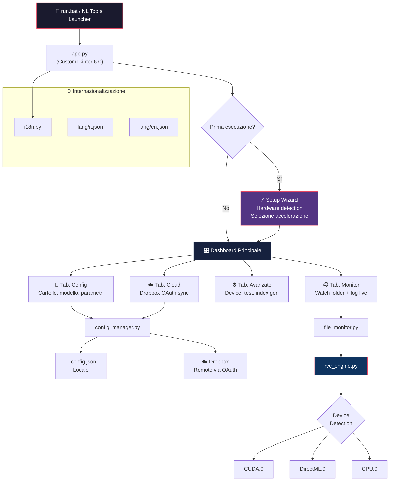

# 🎙️ RVC Portable — Piano Refactoring v2

## Descrizione del Goal

Unificare l'intera applicazione RVC Portable in un'unica GUI moderna con CustomTkinter 6.0, risolvere il bug cloud config, aggiungere supporto Dropbox OAuth per configurazione remota, pulire i pacchetti superflui dal runtime Python 3.12, e preparare l'integrazione nel futuro pacchetto **NL Tools**.

## Cambiamenti rispetto al Piano v1

| Aspetto | Piano v1 | Piano v2 |
|---------|----------|----------|
| Python | 3.9.13 (mantenere) | **3.12.10** (nuovo runtime) |
| RVC engine | `rvc-python` 0.1.5 | **`rvc-python` da installare** + fallback `infer_rvc_python` |
| Fairseq | pip standard | **Fork Py3.12-compat** (`One-sixth/fairseq`) |
| Cloud config | Hot-reload file locale | **Dropbox OAuth** + hot-reload locale |
| Lingua | Solo italiano | **Italiano + Inglese** |
| Pacchetti | ~140, molti duplicati | **Pulizia ~45 pacchetti superflui** (~1.5GB recuperabili) |
| Branding | RVC Portable | RVC Portable → futuro **NL Tools** |

---

## Stato Runtime Attuale (Python 3.12.10)

### Analisi dimensioni

| Componente | Dimensione | Note |
|-----------|-----------|------|
| **NVIDIA CUDA libs** | 1,968 MB | Necessario per GPU NVIDIA |
| **PyTorch** | 4,379 MB | Core - necessario |
| **ONNX Runtime GPU** | 472 MB | Utile per DirectML/NPU |
| **Gradio** | 58 MB | ❌ **Superfluo** — usiamo CustomTkinter |
| **Transformers** | 46 MB | ⚠️ Potrebbe servire per HuBERT |
| **Pandas** | 41 MB | ❌ **Superfluo** per questo uso |
| **Matplotlib** | 26 MB | ❌ **Superfluo** |
| **TOTALE runtime** | **7.72 GB** | Target: ~6 GB dopo pulizia |

### Pacchetti da RIMUOVERE (superflui)

> [!WARNING]
> Prima della rimozione faremo un backup del runtime e test progressivi per assicurarci che nulla si rompa.

```
# GUI/Web non necessari (usiamo CustomTkinter)
gradio              57.7 MB   # Rimpiazzato da CustomTkinter
FreeSimpleGUI        3.9 MB   # Non usato
websockets                    # Dep di gradio

# Visualizzazione/Data (non serve per voice conversion)
matplotlib          26.1 MB   # Non usato nell'inferenza
pandas              40.6 MB   # Non usato
altair                        # Dep di gradio
contourpy                     # Dep di matplotlib
cycler                        # Dep di matplotlib
fonttools                     # Dep di matplotlib
kiwisolver                    # Dep di matplotlib
pyparsing                     # Dep di matplotlib
narwhals                      # Dep di pandas

# Web/API server (non servono per app desktop)
tensorboard          8.6 MB   # Solo per training
tensorboard-data-server       # Dep di tensorboard
grpcio                        # Dep di tensorboard
Markdown                      # Dep di gradio/tensorboard
Werkzeug                      # Dep di tensorboard
absl-py                       # Dep di tensorboard/grpc

# Formato/parsing inutili
orjson                        # Dep di gradio
jsonschema                    # Dep di gradio
jsonschema-specifications     # Dep di jsonschema  
referencing                   # Dep di jsonschema
rpds-py                       # Dep di referencing
entrypoints                   # Dep di gradio
linkify-it-py                 # Dep di gradio
markdown-it-py                # Dep di gradio
mdit-py-plugins               # Dep di gradio
mdurl                         # Dep di markdown-it-py
uc-micro-py                   # Dep di linkify-it-py
ffmpy                         # Dep di gradio, non di ffmpeg-python
pycryptodome                  # Non usato

# Misc non necessari
opencv-python-headless        # Non usato per voice
pydub                         # Ridondante (usiamo soundfile/av)
coloredlogs                   # Dep non essenziale
pyreadline3                   # Solo Windows readline
six                           # Legacy compat

# Potenzialmente non necessari (verifica)
pymss, pymss-core             # Screenshot? Non serve
hyper-connections              # Non chiaro l'uso
torch-einops-utils             # Verificare se torchfcpe lo usa
local-attention                # Verificare se torchfcpe lo usa
```

**Stima risparmio: ~1.5 GB** (pacchetti + dipendenze transitorie)

### Pacchetti da INSTALLARE

```
customtkinter==6.0.0          # GUI moderna
dropbox>=12.0.0               # Dropbox SDK per OAuth
rvc-python==0.1.5             # Engine RVC (da installare)
fairseq @ git+https://github.com/One-sixth/fairseq.git  # Fork Py3.12
watchdog>=6.0.0               # File monitoring (già presente? verificare)
```

### Pacchetti da MANTENERE (core)

```
# Audio processing core
torch, torchaudio, torchfcpe, einops, local-attention
librosa, soundfile, soxr, audioread, av, ffmpeg-python
praat-parselmouth, scipy, numpy, numba, llvmlite
faiss-cpu, scikit-learn, sounddevice

# ML/Model loading
transformers, huggingface_hub, tokenizers, safetensors
onnxruntime-gpu  # Per future accelerazioni DirectML

# NVIDIA CUDA
nvidia-cublas-cu11, nvidia-cuda-nvrtc-cu11, nvidia-cuda-runtime-cu11
nvidia-cudnn-cu11, nvidia-cufft-cu11

# Networking/Config
requests, urllib3, certifi, charset-normalizer, idna
pydantic, PyYAML, regex, click, tqdm, colorama
filelock, platformdirs, packaging

# Server (per future API)
fastapi, starlette, uvicorn, python-multipart
anyio, sniffio, h11
```

---

## Architettura Unificata v2



---

## Proposed Changes

### Componente 1: Internazionalizzazione (`i18n.py` + `lang/`)

#### [NEW] `lang/it.json`
```json
{
    "app_title": "RVC Portable",
    "tab_config": "📁 Configurazione",
    "tab_monitor": "🎧 Monitor",
    "tab_advanced": "⚙️ Avanzate",
    "tab_cloud": "☁️ Cloud",
    "input_dir": "Cartella input",
    "output_dir": "Cartella output",
    "model_path": "Modello (.pth)",
    "index_path": "File .index (opzionale)",
    "pitch": "Pitch shift (semitoni)",
    "method": "Metodo pitch",
    "protect": "Protezione consonanti",
    "index_rate": "Index Rate",
    "device": "Dispositivo",
    "browse": "Sfoglia",
    "save": "Salva",
    "save_as": "Esporta Config...",
    "import_config": "Importa Config...",
    "start_monitor": "▶ Avvia Monitor",
    "stop_monitor": "⏹ Ferma",
    "status_active": "ATTIVO",
    "status_inactive": "Non attivo",
    "status_processing": "Elaborazione...",
    "device_auto": "Auto-detect",
    "device_cuda": "GPU NVIDIA (CUDA)",
    "device_directml": "GPU AMD (DirectML)",
    "device_cpu": "Solo CPU",
    "cloud_connect": "Connetti a Dropbox",
    "cloud_upload": "Carica Config",
    "cloud_download": "Scarica Config",
    "cloud_connected": "Connesso",
    "cloud_disconnected": "Non connesso",
    "error_invalid_input": "Cartella input non valida",
    "error_invalid_output": "Cartella output non valida",
    "error_invalid_model": "File modello non trovato",
    "error_invalid_index": "File index non trovato",
    "success_saved": "Configurazione salvata",
    "powered_by": "Powered by Nicola Lanci — www.nicolalanci.com",
    "language": "Lingua"
}
```

#### [NEW] `lang/en.json`
```json
{
    "app_title": "RVC Portable",
    "tab_config": "📁 Configuration",
    "tab_monitor": "🎧 Monitor",
    "tab_advanced": "⚙️ Advanced",
    "tab_cloud": "☁️ Cloud",
    "input_dir": "Input folder",
    "output_dir": "Output folder",
    "browse": "Browse",
    "save": "Save",
    "start_monitor": "▶ Start Monitor",
    "stop_monitor": "⏹ Stop",
    "powered_by": "Powered by Nicola Lanci — www.nicolalanci.com",
    "language": "Language"
}
```

#### [NEW] `i18n.py`
```python
"""Semplice sistema di internazionalizzazione IT/EN."""
import json, os

class I18n:
    def __init__(self, lang="it"):
        self._strings = {}
        self._lang = lang
        self.load(lang)
    
    def load(self, lang: str):
        path = os.path.join(os.path.dirname(__file__), "lang", f"{lang}.json")
        if os.path.exists(path):
            with open(path, "r", encoding="utf-8") as f:
                self._strings = json.load(f)
            self._lang = lang
    
    def t(self, key: str, **kwargs) -> str:
        """Translate key, with optional format kwargs."""
        text = self._strings.get(key, key)
        return text.format(**kwargs) if kwargs else text
    
    @property
    def lang(self) -> str:
        return self._lang
    
    @staticmethod
    def available() -> list[str]:
        lang_dir = os.path.join(os.path.dirname(__file__), "lang")
        return [f.replace(".json","") for f in os.listdir(lang_dir) if f.endswith(".json")]
```

---

### Componente 2: Config Manager (`config_manager.py`)

#### [NEW] `config_manager.py`

Come nella v1, ma con aggiunta del supporto Dropbox OAuth:

```python
"""Config Manager — con supporto locale e Dropbox OAuth."""
import json, os, time, argparse
from dataclasses import dataclass, asdict, field
from typing import Optional, Callable

@dataclass
class RVCConfig:
    input_dir: str = ""
    output_dir: str = ""
    model_path: str = ""
    index_path: str = ""
    pitch: int = 0
    method: str = "rmvpe"
    protect: float = 0.33
    index_rate: float = 0.3
    device: str = "auto"
    language: str = "it"
    
    def validate(self) -> list[str]:
        errors = []
        if self.input_dir and not os.path.isdir(self.input_dir):
            errors.append(f"input_dir:{self.input_dir}")
        if self.output_dir and not os.path.isdir(self.output_dir):
            errors.append(f"output_dir:{self.output_dir}")
        if self.model_path and not os.path.isfile(self.model_path):
            errors.append(f"model_path:{self.model_path}")
        if self.index_path and not os.path.isfile(self.index_path):
            errors.append(f"index_path:{self.index_path}")
        return errors

class ConfigManager:
    DEFAULT_PATH = "config.json"
    
    def __init__(self, config_path: Optional[str] = None):
        self.config_path = config_path or self.DEFAULT_PATH
        self._last_mtime: Optional[float] = None
        self._config = RVCConfig()
        self._on_change: list[Callable] = []
        self.load()
    
    @classmethod
    def from_args(cls) -> "ConfigManager":
        """FIX BUG CLOUD: parsing argomenti command-line."""
        parser = argparse.ArgumentParser()
        parser.add_argument("--config", "-c", default=cls.DEFAULT_PATH)
        args, _ = parser.parse_known_args()
        return cls(config_path=args.config)
    
    @property
    def config(self) -> RVCConfig:
        return self._config
    
    def load(self) -> bool:
        if not os.path.exists(self.config_path):
            return False
        try:
            self._last_mtime = os.path.getmtime(self.config_path)
            with open(self.config_path, "r", encoding="utf-8") as f:
                data = json.load(f)
            self._config = RVCConfig(**{
                k: v for k, v in data.items() 
                if k in RVCConfig.__dataclass_fields__
            })
            return True
        except (json.JSONDecodeError, OSError):
            return False
    
    def save(self, path: Optional[str] = None) -> bool:
        target = path or self.config_path
        try:
            os.makedirs(os.path.dirname(os.path.abspath(target)), exist_ok=True)
            with open(target, "w", encoding="utf-8") as f:
                json.dump(asdict(self._config), f, indent=4, ensure_ascii=False)
            self._last_mtime = os.path.getmtime(target)
            return True
        except OSError:
            return False
    
    def check_reload(self) -> bool:
        """Hot-reload: controlla se il file è cambiato (cloud sync Dropbox)."""
        if not os.path.exists(self.config_path):
            return False
        try:
            mtime = os.path.getmtime(self.config_path)
            if self._last_mtime is None or mtime > self._last_mtime:
                self.load()
                for cb in self._on_change:
                    cb(self._config)
                return True
        except OSError:
            pass
        return False
    
    def on_change(self, callback: Callable):
        self._on_change.append(callback)
```

---

### Componente 3: Dropbox Cloud Sync (`cloud_sync.py`)

#### [NEW] `cloud_sync.py`

```python
"""Cloud Sync — Upload/Download config.json via Dropbox OAuth2 PKCE."""
import json, os, webbrowser, threading
from typing import Optional, Callable

class DropboxSync:
    """Sincronizzazione config con Dropbox usando OAuth2 PKCE (no server)."""
    
    APP_KEY = ""  # Da configurare con App Key Dropbox
    TOKEN_FILE = ".dropbox_token.json"
    REMOTE_PATH = "/RVCPortable/config.json"
    
    def __init__(self):
        self._dbx = None
        self._token = self._load_token()
    
    @property
    def is_connected(self) -> bool:
        return self._dbx is not None
    
    def connect(self, callback: Optional[Callable] = None):
        """Avvia OAuth2 PKCE flow — apre il browser per autorizzazione."""
        try:
            import dropbox
            from dropbox import DropboxOAuth2FlowNoRedirect
            
            flow = DropboxOAuth2FlowNoRedirect(
                self.APP_KEY, use_pkce=True, token_access_type='offline'
            )
            authorize_url = flow.start()
            webbrowser.open(authorize_url)
            # Il callback chiederà il codice all'utente nella GUI
            if callback:
                callback(flow)
        except ImportError:
            raise RuntimeError("Dropbox SDK non installato: pip install dropbox")
    
    def complete_auth(self, flow, auth_code: str) -> bool:
        """Completa l'autenticazione con il codice dell'utente."""
        import dropbox
        try:
            result = flow.finish(auth_code)
            self._dbx = dropbox.Dropbox(
                oauth2_access_token=result.access_token,
                oauth2_refresh_token=result.refresh_token,
                app_key=self.APP_KEY
            )
            self._save_token(result)
            return True
        except Exception:
            return False
    
    def upload_config(self, local_path: str) -> bool:
        """Carica config.json su Dropbox."""
        import dropbox
        if not self._dbx:
            return False
        with open(local_path, "rb") as f:
            self._dbx.files_upload(
                f.read(), self.REMOTE_PATH,
                mode=dropbox.files.WriteMode.overwrite
            )
        return True
    
    def download_config(self, local_path: str) -> bool:
        """Scarica config.json da Dropbox."""
        if not self._dbx:
            return False
        try:
            _, response = self._dbx.files_download(self.REMOTE_PATH)
            with open(local_path, "wb") as f:
                f.write(response.content)
            return True
        except Exception:
            return False
    
    def _load_token(self) -> Optional[dict]:
        if os.path.exists(self.TOKEN_FILE):
            with open(self.TOKEN_FILE, "r") as f:
                return json.load(f)
        return None
    
    def _save_token(self, result):
        with open(self.TOKEN_FILE, "w") as f:
            json.dump({
                "access_token": result.access_token,
                "refresh_token": result.refresh_token
            }, f)
```

---

### Componente 4: RVC Engine (`rvc_engine.py`)

#### [NEW] `rvc_engine.py`

```python
"""RVC Engine — Motore conversione con fallback chain e Python 3.12 support."""
import os, subprocess, sys
from dataclasses import dataclass
from typing import Optional, Callable

@dataclass
class ConversionResult:
    success: bool
    output_path: str = ""
    error: str = ""
    duration_s: float = 0

class RVCEngine:
    def __init__(self):
        self.device = self.detect_device()
        self._python = self._find_python()
    
    @staticmethod
    def detect_device() -> str:
        """Fallback: CUDA → DirectML → CPU"""
        try:
            import torch
            if torch.cuda.is_available():
                gpu_name = torch.cuda.get_device_name(0)
                return f"cuda:0"  # + info: gpu_name
        except ImportError:
            pass
        try:
            import torch_directml
            return "dml:0"
        except ImportError:
            pass
        return "cpu:0"
    
    @staticmethod
    def get_device_info() -> dict:
        """Info completa sull'hardware rilevato."""
        info = {"device": "cpu:0", "gpu_name": "N/A", "vram": "N/A"}
        try:
            import torch
            if torch.cuda.is_available():
                info["device"] = "cuda:0"
                info["gpu_name"] = torch.cuda.get_device_name(0)
                vram = torch.cuda.get_device_properties(0).total_mem / (1024**3)
                info["vram"] = f"{vram:.1f} GB"
        except ImportError:
            pass
        return info
    
    def _find_python(self) -> str:
        base = os.path.dirname(os.path.abspath(__file__))
        runtime = os.path.join(base, "runtime", "python.exe")
        return runtime if os.path.isfile(runtime) else sys.executable
    
    def convert(self, input_path: str, output_path: str, model_path: str,
                index_path: str = "", pitch: int = 0, method: str = "rmvpe",
                protect: float = 0.33, index_rate: float = 0.3,
                device: str = "auto", 
                on_output: Optional[Callable[[str], None]] = None) -> ConversionResult:
        """Converte un file audio con RVC."""
        import time
        start = time.time()
        dev = device if device != "auto" else self.device
        
        cmd = [
            self._python, "-m", "rvc_python", "cli",
            "-i", input_path, "-o", output_path, "-mp", model_path,
            "-de", dev, "-me", method,
            "-pr", str(protect), "-pi", str(pitch), "-ir", str(index_rate),
        ]
        if index_path:
            cmd += ["-ip", index_path]
        
        try:
            proc = subprocess.Popen(
                cmd, stdout=subprocess.PIPE, stderr=subprocess.STDOUT,
                text=True, bufsize=1
            )
            for line in proc.stdout:
                if on_output:
                    on_output(line.rstrip())
            proc.wait()
            elapsed = time.time() - start
            
            if proc.returncode == 0:
                return ConversionResult(True, output_path, duration_s=elapsed)
            else:
                return ConversionResult(False, error=f"Exit code: {proc.returncode}")
        except Exception as e:
            return ConversionResult(False, error=str(e))
```

---

### Componente 5: File Monitor (`file_monitor.py`)

#### [NEW] `file_monitor.py`

Come piano v1 — modulo pulito e modulare per monitorare la cartella input.

---

### Componente 6: GUI Principale (`app.py`)

#### [NEW] `app.py`

L'applicazione CustomTkinter unificata con 4 tab:

**Tab Layout:**

```
┌──────────────────────────────────────────────────────────┐
│  🎙️ RVC Portable                    [🌐 IT ▼] [─][□][×] │
├──────────────────────────────────────────────────────────┤
│  [📁 Configurazione] [🎧 Monitor] [⚙️ Avanzate] [☁️ Cloud]│
├──────────────────────────────────────────────────────────┤
│                                                          │
│  📁 Configurazione                                       │
│  ┌────────────────────────────────────────────────────┐  │
│  │ Cartella input:  [_____________________________][…]│  │
│  │ Cartella output: [_____________________________][…]│  │
│  │ Modello (.pth):  [_____________________________][…]│  │
│  │ File .index:     [_____________________________][…]│  │
│  │                                                    │  │
│  │ Pitch: [-12 ←━━━━●━━━━━→ +12]  Metodo: [rmvpe ▼] │  │
│  │ Protezione: [0.0 ←━━━●━━━━→ 0.5]                  │  │
│  │ Index Rate: [0.0 ←━●━━━━━━→ 1.0]                  │  │
│  │ Device: [🔍 Auto-detect ▼]  ← CUDA:0 (RTX 3060)   │  │
│  │                                                    │  │
│  │  [💾 Salva]  [📤 Esporta...]  [📥 Importa...]      │  │
│  └────────────────────────────────────────────────────┘  │
│                                                          │
│  🎧 Monitor                                              │
│  ┌────────────────────────────────────────────────────┐  │
│  │ ● Stato: 🟢 ATTIVO — cuda:0                       │  │
│  │ [▶ Avvia]  [⏹ Ferma]  [🔄 Riprocessa esistenti]   │  │
│  │                                                    │  │
│  │ ┌── Log ────────────────────────────────────────┐  │  │
│  │ │ 13:45:22 ✅ file1.wav → convertito (3.2s)    │  │  │
│  │ │ 13:45:30 📂 Nuovo file: file2.mp3             │  │  │
│  │ │ 13:45:35 🔄 Elaborazione file2.mp3...         │  │  │
│  │ │ 13:45:48 ✅ file2.mp3 → convertito (12.8s)   │  │  │
│  │ └──────────────────────────────────────────────┘  │  │
│  └────────────────────────────────────────────────────┘  │
│                                                          │
│  ☁️ Cloud                                                 │
│  ┌────────────────────────────────────────────────────┐  │
│  │ Dropbox: 🟢 Connesso                              │  │
│  │ [Connetti]  [📤 Upload Config]  [📥 Download Config]│ │
│  │                                                    │  │
│  │ ─── oppure ───                                     │  │
│  │ Config da path di rete/cloud:                      │  │
│  │ [J:\Dropbox\TestRVC\config.json_________][Sfoglia] │  │
│  │ ☑ Hot-reload automatico (controlla ogni 2s)        │  │
│  └────────────────────────────────────────────────────┘  │
│                                                          │
├──────────────────────────────────────────────────────────┤
│ 🔌 cuda:0 (NVIDIA RTX 3060) │ Files: 42 │ v2.0.0 │ NL  │
└──────────────────────────────────────────────────────────┘
```

**Key implementation details:**
- `customtkinter.CTk` come finestra principale
- `CTkTabview` per i 4 tab
- `CTkSlider` per protect/index_rate/pitch (molto più intuitivo degli Entry)
- Thread separato per il monitor (non blocca la GUI)
- `after()` di Tkinter per aggiornare il log senza threading issues
- Status bar con info device e contatore file
- Selettore lingua in alto a destra

---

### Componente 7: Struttura File Finale

```
rvc-portable/
├── app.py                    # [NEW] GUI unificata CustomTkinter
├── rvc_engine.py             # [NEW] Motore conversione + device detection
├── config_manager.py         # [NEW] Config con hot-reload + cloud support
├── cloud_sync.py             # [NEW] Dropbox OAuth2 PKCE
├── file_monitor.py           # [NEW] Monitor cartella modulare
├── i18n.py                   # [NEW] Internazionalizzazione
├── setup_wizard.py           # [NEW] Wizard hardware (prima esecuzione)
├── run.bat                   # [NEW] Launcher unico
├── run.py                    # [NEW] Entry point Python con error handling
│
├── lang/                     # [NEW] File di traduzione
│   ├── it.json
│   └── en.json
│
├── config.json               # Configurazione (retrocompatibile)
├── hardware_profile.json     # [NEW] Profilo hardware dal wizard
│
├── runtime/                  # Python 3.12 (pulito)
├── Modelli/                  # Modelli voce (invariato)
├── assets/                   # [NEW] Icone e risorse GUI
│
├── legacy/                   # [NEW] File vecchi archiviati
│   ├── config_gui.py
│   ├── monitor.py
│   ├── launcher_monitor.py
│   ├── Avvia-RVC.bat
│   ├── Avvia-RVC-config-cloud.bat
│   └── Configura-cartelle.bat
│
├── Backup/                   # (invariato)
├── Progetto/                 # (invariato)
└── Test/                     # (invariato)
```

---

## Fasi di Implementazione

### Fase 1: Preparazione (sicura, nessun file toccato)
1. ✅ Backup runtime attuale
2. Installare `customtkinter` nel runtime
3. Installare `rvc-python` + fairseq fork nel runtime
4. Installare `dropbox` SDK  
5. Verificare che `watchdog` sia presente
6. Creare struttura cartelle (`lang/`, `assets/`, `legacy/`)

### Fase 2: Codice core (nuovi file, nessuna modifica ai vecchi)
1. `i18n.py` + `lang/it.json` + `lang/en.json`
2. `config_manager.py`
3. `rvc_engine.py`
4. `file_monitor.py`
5. `cloud_sync.py`
6. Test unitari di ogni modulo

### Fase 3: GUI (nuovo file)
1. `app.py` — GUI completa
2. `setup_wizard.py` — wizard hardware
3. `run.py` + `run.bat` — launcher
4. Test integrazione GUI ↔ engine

### Fase 4: Pulizia
1. Rimuovere pacchetti superflui dal runtime (con test progressivi)
2. Spostare file vecchi in `legacy/`
3. Aggiornare `requirements-win.txt`
4. Test finale end-to-end

---

## Verification Plan

### Test Automatici (per ogni fase)

```bash
# Fase 1: Verifica installazione
runtime\python.exe -c "import customtkinter; print('CTk', customtkinter.__version__)"
runtime\python.exe -c "from rvc_python.infer import RVCInference; print('RVC OK')"
runtime\python.exe -c "import dropbox; print('Dropbox SDK OK')"

# Fase 2: Test moduli core
runtime\python.exe -c "
from config_manager import ConfigManager
cm = ConfigManager('config.json')
print('Load:', cm.config.input_dir)
cm.config.pitch = 7
cm.save('test_config.json')
cm2 = ConfigManager('test_config.json')
assert cm2.config.pitch == 7, 'FAIL'
print('Config Manager: PASS')
"

runtime\python.exe -c "
from rvc_engine import RVCEngine
e = RVCEngine()
print('Device:', e.device)
info = e.get_device_info()
print('GPU:', info)
print('RVC Engine: PASS')
"

runtime\python.exe -c "
from i18n import I18n
i = I18n('it')
print(i.t('app_title'))
i.load('en')
print(i.t('app_title'))
print('I18n: PASS')
"

# Fase 3: Test GUI (si avvia e si chiude)
runtime\python.exe -c "
import customtkinter as ctk
app = ctk.CTk()
app.geometry('100x100')
app.after(1000, app.destroy)
app.mainloop()
print('GUI Test: PASS')
"

# Fase 4: Verifica post-pulizia
runtime\python.exe -c "
import torch, torchaudio, librosa, soundfile, numpy, scipy
import faiss, watchdog, requests, pydantic
print('All core imports: PASS')
"
```

### Verifica Manuale

1. **Doppio click `run.bat`** → Si apre la GUI con tab
2. **Selettore lingua** → Cambia IT↔EN, tutte le label si aggiornano
3. **Tab Config** → Carica/salva config, slider funzionanti
4. **Tab Monitor** → Avvia, copia .wav in input, verifica conversione + log
5. **Tab Cloud** → Connetti Dropbox, upload/download config
6. **Test config remota** → Importa config da path rete, hot-reload funziona
7. **Device detection** → Status bar mostra GPU/CPU corretto
